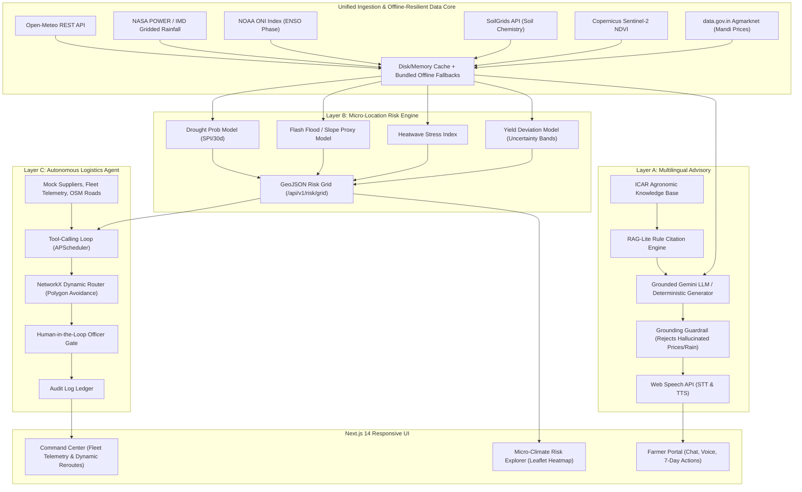

# KisanShield (किसानशील्ड)
**Climate-Resilient Agri Advisory + Autonomous Emergency Relief Engine**  
*Track: Systemic Climate & Supply-Chain Resilience (India Focus)*

---

## 🌟 Executive Summary

**KisanShield** is an integrated agro-climate intelligence and autonomous disaster relief system designed for Indian agriculture. It connects smallholder farmers to hyper-local, grounded voice guidance while equipping district authorities with an autonomous, hazard-aware relief logistics engine.

One platform, three interconnected layers sharing a unified data core:
- **Layer A**: **Multilingual Agritech Advisory Assistant** (Farmer-facing, Web Speech voice + chat in Hindi, Marathi, Bengali, Tamil, Telugu, and English, ICAR-grounded RAG-lite, "Next 7 Days" action cards, and "Sell Now vs Hold" mandi signals).
- **Layer B**: **Predictive Micro-Location Climate & Yield Risk Engine** (1–5 km micro-grid analytics covering 30-day drought probability, flash-flood index, heatwave stress, yield deviations with 90% confidence bands, and NOAA ENSO ONI index correlation).
- **Layer C**: **Autonomous Emergency Response & Logistics Agent** (Tool-calling orchestrator with continuous monitor, dynamic NetworkX road routing that avoids live hazard polygons, mid-transit dynamic rerouting, Human-in-the-Loop approval gate, and real-time command center).

---

## 📐 Architecture Diagram



---

## 🚀 Quick Start Guide

### Option 1: One-Command Startup via Docker Compose
Ensure Docker Desktop is running, then execute:
```bash
docker compose up --build
```
- **Frontend**: [http://localhost:3000](http://localhost:3000)
- **Backend API Docs**: [http://localhost:8000/docs](http://localhost:8000/docs)

---

### Option 2: Local Native Startup (Windows / macOS / Linux)

#### 1. Setup Backend (Python 3.11+)
```bash
# In project root
python -m pip install -r backend/requirements.txt

# Run backend server
python -m uvicorn backend.app.main:app --host 0.0.0.0 --port 8000 --reload
```

#### 2. Setup Frontend (Node 18+)
```bash
cd frontend
npm install
npm run dev
```
Open [http://localhost:3000](http://localhost:3000) in your browser.

---

## 🧪 Running Automated Tests

Run the complete 17-test test suite covering adapters, risk models, dynamic routing, LLM grounding guardrails, and logistics orchestration:
```bash
python -m pytest tests/ -v
```

Run the ML backtesting evaluation script:
```bash
python ml/evaluate_models.py
```
Outputs:
- **Drought Model ROC-AUC**: `0.994` | **Brier Score**: `0.079`
- **Flash-Flood F1 Score**: `0.990`
- **Yield Model MAE**: `2.86%` | **90% Confidence Interval Coverage**: `89.3%`

---

## 🗺️ Seed Scenario Reference

- **District 1 (Drought-Prone)**: Solapur, Maharashtra (Semi-arid Deccan Plateau, Vertisols, Soybean/Cotton)
- **District 2 (Flood-Prone)**: Darbhanga, Bihar (Kosi Basin Floodplain, Alluvial Silts, Rice/Potato)
- **District 3 (Coastal Heat)**: Cuddalore, Tamil Nadu (Coromandel Coast, Marine Heat Stress, Rice/Cotton)
- **Suppliers**: 10 mock agricultural depots stocking seeds, de-watering pumps, fodder, water bladders, tarpaulins.
- **Fleet**: 8 relief vehicles (water tankers, 4x4 trucks, emergency pumps) with live GPS telemetry.

---

## 📚 Deliverable Documents
- [Architecture & Data Flow Documentation](file:///c:/Users/palar/Desktop/Forge/docs/ARCHITECTURE.md)
- [3-Minute Demo Script](file:///c:/Users/palar/Desktop/Forge/docs/DEMO_SCRIPT.md)
- [Pitch Deck Outline](file:///c:/Users/palar/Desktop/Forge/docs/PITCH_DECK_OUTLINE.md)

