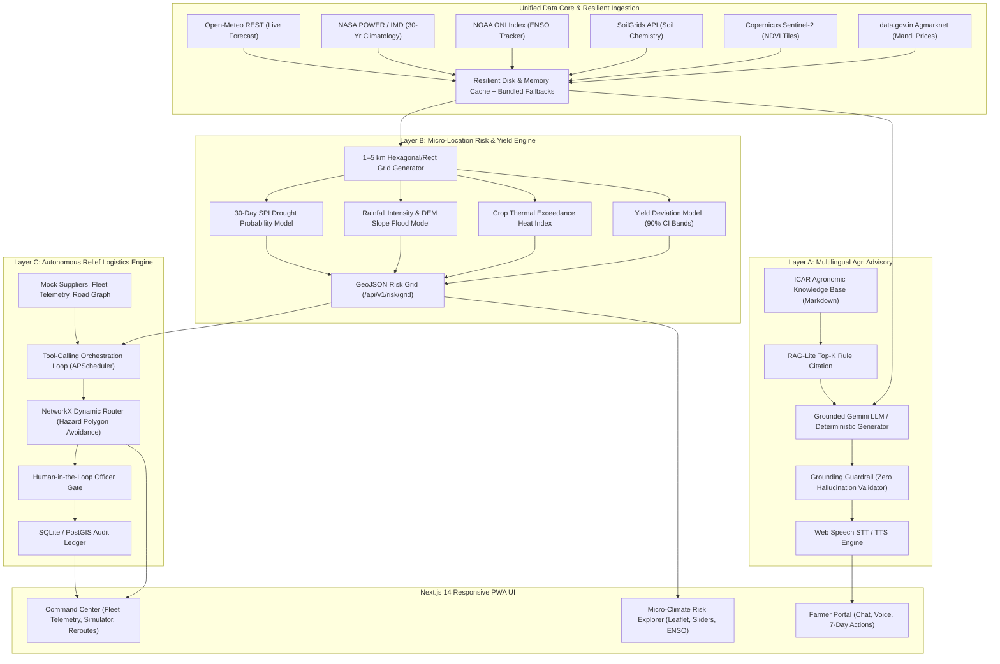
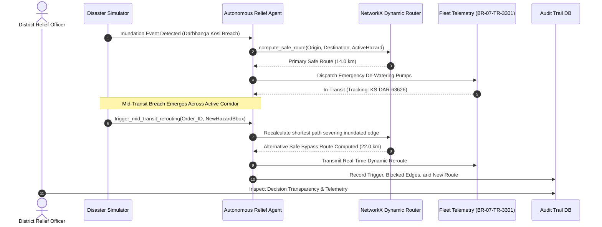

# KisanShield System Architecture & Data Flow

KisanShield is an enterprise-grade, climate-resilient agriculture intelligence and autonomous emergency logistics engine tailored for Indian smallholder farmers and district disaster management authorities.

---

## 1. High-Level System Architecture

---

## 2. Dynamic Mid-Transit Hazard Rerouting Flow (Layer C)

---

## 3. Data Flow & Provenance Badging

Every alert and advisory in KisanShield explicitly carries provenance metadata:
1. **Weather**: Open-Meteo 7-day live API with 1-hour in-memory cache and bundled NASA POWER/IMD historical fallbacks.
2. **Mandi Prices**: data.gov.in Agmarknet API parsed with 15-day moving average and trend signals (`HOLD` vs `SELL NOW`).
3. **Soil Attributes**: SoilGrids REST endpoint with regional default profiles (Vertisols, Alluvial, Coastal).
4. **Satellite Vegetation**: Sentinel-2 MSI NDVI raster tiles with negative anomaly stress detection.
5. **Macro-Climate**: NOAA Oceanic Niño Index (ONI) tracking El Niño / La Niña phases and regional correlation coefficients.

